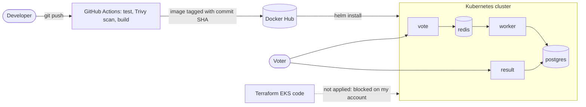

# Capstone 1: Voting App

Short description: what the app is and what this project adds.

## Architecture
(architecture diagram goes here, we'll make it near the end)

## Step 1: Run it locally
## Step 2: Containerize it safely
## Step 3: Kubernetes cluster with Terraform
## Step 4: Automate with GitHub Actions
## Step 5: Deploy and roll back with Helm

## Step 1: Run it locally

```bash
git clone https://github.com/<thatonejoee>/example-voting-app.git
cd example-voting-app
docker compose up --build
```

Vote page: http://localhost:8080
Result page: http://localhost:8081


## Step 2: Containerize it safely

Changes made:

- **Pinned base images:** `python:3.11.9-slim AS base`, `node:18.20.4-slim`, `dotnet 7.0` (SDK and runtime), `redis:8.4-alpine`, so builds are repeatable.
- **Run as non-root:** `vote` and `worker` run as `appuser` (uid 10001) and `result` runs as `node` (uid 1000), which limits damage if a container is compromised.
- **Added `.dockerignore` files** to `vote`, `result` and `worker` so git history, caches and secrets aren't copied into images.

How I verified it:

```bash
docker build --target final -t vote-final ./vote
docker run --rm vote-final id
docker compose exec result id
docker compose exec worker id
```

Each command printed a non-root user.

Step 3: Terraform code is in /terraform and passes terraform validate, but my AWS account blocks EKS through an organization policy, so I couldn’t create the cluster.
Step 5 and the rollback were demonstrated on a local kind cluster.
The pipeline builds, scans and pushes, and I installed with Helm by hand.
The original app hardcodes the database password in its source.

## Step 4: Automate with GitHub Actions

The pipeline is defined in `.github/workflows/ci.yml` and runs on every push to `main` (it can also be started by hand from the Actions tab).

**Job 1: test**
- Starts the whole app with `docker compose up --build`.
- Casts a vote through the vote service.
- Checks that the vote reaches PostgreSQL (vote → Redis → worker → database).
- Prints the container logs if anything fails.

**Job 2: build-scan-push** (runs for `vote`, `result` and `worker`, only if `test` passes)
1. Builds the image from its Dockerfile.
2. Scans it with Trivy for HIGH and CRITICAL vulnerabilities. It currently reports findings without failing the build, because some pinned base images (Node 18, .NET 7) are past end of life and will show findings.
3. Logs in to Docker Hub.
4. Pushes the image tagged with the commit SHA, for example `thatonejoee/voting-vote:<commit-sha>`.

**Secrets:** `DOCKERHUB_USERNAME` and `DOCKERHUB_TOKEN` are stored as GitHub repository secrets. No credentials are in the repo.

**Why the original test was replaced:** the test that came with the repo builds a PhantomJS image on `node:8.9`, based on a Debian release whose package servers no longer exist. I replaced it with the compose smoke test above.


## Step 5: Deploy and roll back with Helm

One chart (`helm/voting-app`) and one values file deploy all five services. The image tag is passed in at deploy time (`--set global.tag=<commit-sha>`), and the database password is supplied at install time and stored in a Kubernetes Secret, not in Git.

Tested on a local `kind` cluster (my AWS account blocks EKS, see Step 3).

**Rollback demo:** I deployed a release with an image tag that doesn't exist. Helm waited for the new pods, they never became healthy, and the upgrade failed. The old pods kept serving traffic. `helm rollback` then restored the good release.

```
REVISION        UPDATED                         STATUS          CHART                   APP VERSION    DESCRIPTION                                       
1               Mon Oct 26 23:35:22 2026        superseded      voting-app-0.1.0        1.0.0        Install complete                                  
2               Tue Oct 27 15:44:29 2026        failed          voting-app-0.1.0        1.0.0        Upgrade "voting" failed: context deadline exceeded
3               Tue Oct 27 15:47:08 2026        deployed        voting-app-0.1.0        1.0.0        Rollback to 1                                     

```

## Architecture



# Example Voting App

A simple distributed application running across multiple Docker containers.

## Getting started

Download [Docker Desktop](https://www.docker.com/products/docker-desktop) for Mac or Windows. [Docker Compose](https://docs.docker.com/compose) will be automatically installed. On Linux, make sure you have the latest version of [Compose](https://docs.docker.com/compose/install/).

This solution uses Python, Node.js, .NET, with Redis for messaging and Postgres for storage.

Run in this directory to build and run the app:

```shell
docker compose up
```

The `vote` app will be running at [http://localhost:8080](http://localhost:8080), and the `results` will be at [http://localhost:8081](http://localhost:8081).

Alternately, if you want to run it on a [Docker Swarm](https://docs.docker.com/engine/swarm/), first make sure you have a swarm. If you don't, run:

```shell
docker swarm init
```

Once you have your swarm, in this directory run:

```shell
docker stack deploy --compose-file docker-stack.yml vote
```

## Run the app in Kubernetes

The folder k8s-specifications contains the YAML specifications of the Voting App's services.

Run the following command to create the deployments and services. Note it will create these resources in your current namespace (`default` if you haven't changed it.)

```shell
kubectl create -f k8s-specifications/
```

The `vote` web app is then available on port 31000 on each host of the cluster, the `result` web app is available on port 31001.

To remove them, run:

```shell
kubectl delete -f k8s-specifications/
```

## Architecture


* A front-end web app in [Python](/vote) which lets you vote between two options
* A [Redis](https://hub.docker.com/_/redis/) which collects new votes
* A [.NET](/worker/) worker which consumes votes and stores them in…
* A [Postgres](https://hub.docker.com/_/postgres/) database backed by a Docker volume
* A [Node.js](/result) web app which shows the results of the voting in real time

## Notes

The voting application only accepts one vote per client browser. It does not register additional votes if a vote has already been submitted from a client.

This isn't an example of a properly architected perfectly designed distributed app... it's just a simple
example of the various types of pieces and languages you might see (queues, persistent data, etc), and how to
deal with them in Docker at a basic level.
